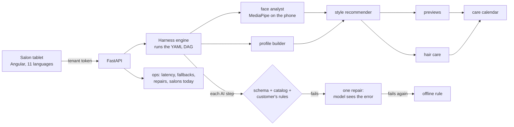

# Aaina — the AI mirror for salons

One photo and a few questions; Aaina recommends the three haircuts that truly suit a
customer, with previews, a hair routine, a face routine, a 360° profile and a care
calendar that brings them back on time. Multi-tenant: every salon gets its own link.

* `backend/` — FastAPI + the agent **harness** (agents and workflows are YAML)
* `frontend/` — Angular 21, mobile first, works on phones, tablets and the salon TV
* `docs/ARCHITECTURE.md` — the design: harness, providers, tenancy, privacy
* `docs/SYSTEM_DESIGN.md` — the whole system: requirements, data model, decisions, failure modes, scaling, interview Q&A

**Live:** app https://aaina-ai.vercel.app · API https://aaina-api.onrender.com/api/health · [](https://github.com/RavSinghChandan/aaina/actions/workflows/ci.yml)

## How it works



- **The model never sees a choice it may not make.** Before the style recommender runs, the harness cuts the catalog down to what this customer allows: their audience, nothing they dislike, nothing far above the upkeep they want. The answer is checked against the same rules after, in code.
- **One repair, then a safe fallback.** If an answer breaks the schema or the rules, the model gets one retry with the exact error. If that fails too, a deterministic offline rule answers, so a customer in the chair always gets three valid haircuts.
- **Features are data.** A new agent is a YAML file (prompt, inputs, output schema, UI view, offline rule) plus one line in a workflow. No core code changes.

## Evals

`python -m evals.run` (offline rules, free, in CI) and `python -m evals.run --live`
(the real model). 15 customer profiles across men and women, 6 languages, six
face shape, low to high upkeep, each with things they dislike. Every
recommendation is checked in code:

| Check | Live model, prompt rules only | Live model, rules enforced by the harness |
|---|---|---|
| Style exists in the catalog | 100% | 100% |
| Right audience (men / women) | 100% | 100% |
| **Nothing the customer dislikes** | **80%** (3 of 15 broke it) | **100%** |
| No high-upkeep cut for a low-upkeep customer | 100% | 100% |
| Three different styles | 100% | 100% |
| Written in the customer's language | 100% | 100% |
| AI answer kept (no fallback to rules) | 100% (recommender step) | 100% (every AI step; 1 answer repaired) |

*Before* is the same model and prompt with the dislike rule only in the prompt:
a customer who said "no fade" was offered a low taper fade. Model: DeepSeek, run
on 9 Oct 2026; p50 about 5 s per consultation. Raw results are in
`backend/evals/`. The profiles were written by me, and 15 is a small set: the
point is that the rule is now enforced in code and checked on every build.

## Running it

| | |
|---|---|
| **Ops panel** | `/admin` (admin key): consultations, server-error rate, API calls, AI answers repaired, and per agent step the runs, how often the AI answer was kept or fell back, and p50/p95 latency. JSON at `GET /api/admin/ops`. |
| **Sign-in** | A salon registers; the owner approves it at `/admin` and sends a signed tenant key with a one-click link. A salon can only read its own customers. |
| **Limits** | Daily caps per user and for the whole app, and a monthly consultation limit per salon plan. |
| **Integration** | `GET /api/t/{salon}/customers.csv` (signed-in salon only): name, phone, visits, last style and next trim date, for the salon's billing app, CRM or WhatsApp tool. Full API at `/docs`. |

---

## Run it locally

```bash
# API  (http://localhost:8000)
cd backend
python3 -m venv .venv && .venv/bin/pip install -r requirements-dev.txt
cp .env.example .env              # add DEEPSEEK_API_KEY for AI recommendations; leave empty for offline mode
.venv/bin/uvicorn app.main:app --reload --port 8000

# App  (http://localhost:4200)
cd frontend
npm install && npx ng serve
```

Open `http://localhost:4200/t/demo` — a demo salon is created automatically.

Tests: `cd backend && .venv/bin/python -m pytest` (14 tests, no API key needed).

### Offline, DeepSeek, or Claude (`AAINA_LLM`)

| | Offline (no key) | DeepSeek (default) | Claude (optional) |
|---|---|---|---|
| Face & hair analysis | From answers | From answers (DeepSeek is text-only) | From the photo |
| Recommendations | Scoring rules over the catalog | AI, grounded in the same catalog | AI, grounded in the catalog |
| Profile & routines | Rules | AI, personalised | AI, personalised |
| Previews, calendar | Same | Same | Same |

A live DeepSeek consultation takes about 11 seconds and costs a fraction of a rupee.

If the AI fails or answers outside the schema or catalog, that step falls back to the
offline rule automatically — a consultation never breaks in front of a customer.

---

## Deploy for free (about 15 minutes)

1. **Database — Neon (free).** Create a project at neon.tech, copy the Postgres
   connection string. (Render's free disk is wiped on every deploy; don't use SQLite there.)
2. **API — Render (free).** Push this repo to GitHub, then in Render:
   *New → Blueprint →* select the `aaina` repo (it reads `render.yaml` at the root). Set:
   * `DATABASE_URL` = the Neon string
   * `DEEPSEEK_API_KEY` = your DeepSeek key (leave empty to run fully offline)
   * `ALLOWED_ORIGINS` = your Vercel URL, e.g. `https://aaina.vercel.app`
   * `ADMIN_KEY` is generated — keep it; you need it to create salons.
   * To give a teammate admin access, add `ADMIN_KEYS` as `name:key` pairs separated by commas (a key of 16+ characters each). Each person gets their own key, the audit log shows who approved what, and removing a pair revokes only that person.
   Check `https://<your-service>.onrender.com/api/health`.
3. **App — Vercel.** In `frontend/src/app/core/config.ts` set `PROD_API` to your Render
   URL, then `cd frontend && npx vercel deploy --prod`. Add your own domain in Vercel.
4. **First salon.** Open `https://<your-app>/start`, enter the salon name and the
   `ADMIN_KEY`, and share the link it gives you.

Free-tier note: Render's free service sleeps after 15 minutes idle and takes ~50 s to
wake. Open the salon link a minute before a demo, or move to the $7 plan once paying.

---

## Add a feature without touching core code

Example — a beard-style agent for men's salons:

1. Create `backend/manifests/agents/80_beard_stylist.yaml`:
   ```yaml
   id: beard_stylist
   title: Beard style
   kind: llm
   needs_image: true
   inputs: [analysis, profile]
   system: You recommend beard styles for an Indian men's salon...
   prompt: "Analysis: {{ analysis }}  Profile: {{ profile }}"
   output_schema:
     type: object
     properties:
       daily: { type: array, items: { type: object, properties: { step: { type: string }, why: { type: string } } } }
   ui: { view: routine, title: Beard style & care, order: 45 }
   offline: { rule: skin_care_planner }   # any existing rule as a safety net
   ```
2. Add one line to `backend/manifests/workflows/consultation.yaml`:
   ```yaml
   - { id: beard, agent: beard_stylist, needs: [analysis, profile] }
   ```
3. Restart the API. The new tab appears in the app, rendered by the existing `routine`
   view. Questions work the same way: add a field to `manifests/forms/intake.yaml`.
   New haircuts: add them to `catalog/hairstyles.yaml`.

Available views: `facts`, `options`, `routine`, `profile`, `timeline` (anything else
renders as a readable key–value list).

---

## Privacy (India, DPDP Act 2023)

Explicit consent before any photo; photos are processed in memory and **not stored**
unless the salon enables it and the customer agrees; no genetic data; optional photos
are uploaded by the customer, never scraped; one call erases a customer
(`DELETE /api/t/{salon}/customers/{id}`). Advice is grooming guidance, not medical advice.

## Not built yet

Roles inside a salon (owner vs stylist), Razorpay subscriptions (usage is already metered per salon per month),
automated WhatsApp reminders (one-tap `wa.me` links work today), and a photorealistic
image model for previews (plug it into `app/providers/images.py`).
