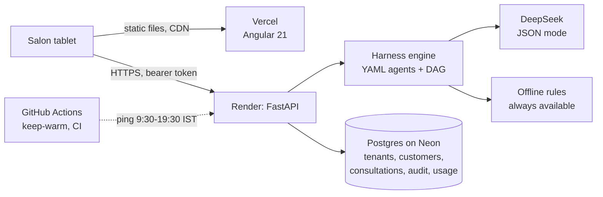

# Aaina — system design

How the system is built, why each choice was made, how it fails, and what changes
as it grows. [ARCHITECTURE.md](ARCHITECTURE.md) covers the harness, tenancy and
privacy in depth; this page is the whole system.

## 1. The business problem

In most Indian salons the haircut is chosen by the customer pointing at a photo
on a phone, or by the stylist's habit. A cut that does not suit the face shape,
hair type or the upkeep the customer will actually do means an unhappy customer
who does not come back. Repeat visits are the salon's business.

| Who | What they need |
|---|---|
| Stylist | Three cuts that suit this customer, with a reason, in under a minute |
| Customer | To see the options, care tips and when to come back, in their language |
| Salon owner | Customer history and follow-ups, so people come back on time |
| Owner of Aaina (me) | Approve salons, keep the AI bill bounded, see that it is healthy |

**Functional:** one photo plus three picture questions; face shape measured on
the phone; three recommended cuts from a 26-style catalog with previews; hair and
face routines; a care calendar and follow-up list with WhatsApp reminders; 11
languages; multi-tenant (every salon sees only its own customers); customer
export (CSV); erasure on request.

**Non-functional:**

| Requirement | Target | How |
|---|---|---|
| First screen | under 5 s | Angular on Vercel's CDN; the API wakes in the background |
| A consultation | ~10 s with the live model | DAG runs independent steps in parallel |
| Every result valid | 3 allowed cuts, always | schema + catalog rules in code, one repair, then an offline rule |
| Tenant isolation | no cross-salon reads | `tenant_id` on every row and in every query; signed tenant token |
| Privacy (DPDP Act 2023) | photos not kept by default | consent before analysis; photo stored only if salon and customer opt in; erasure endpoint |
| Cost | bounded AI bill on free hosting | daily caps per user (10), per network (6), whole app (150), in the database |
| Data | survives restarts | Postgres (Neon) via `DATABASE_URL` |

## 2. Back of the envelope

A busy salon does ~20 consultations a day. At 50 salons that is ~1,000 a day,
each about 5 model calls: ~5,000 calls a day. At ~10 s per consultation and a
peak of maybe 20 at once, the bottleneck is model latency and the AI bill, not
the server. That is why runs are async (202 + polling) and why the caps count
consultations.

Storage: a customer ~1 KB, a consultation ~10-20 KB of JSON (answers, steps,
outputs), no photos by default. 50 salons x 20 a day x 365 x 20 KB is about
7 GB a year at full use, so a paid Postgres tier or archiving old consultations
comes in the second year. Today it is far below Neon's free 0.5 GB.

## 3. Architecture

**A consultation, step by step**

1. `POST /api/t/{slug}/consultations` checks the token's salon matches `slug`,
   checks consent, charges the daily caps, saves the consultation as `queued`,
   and returns **202** with its id at once.
2. A background task runs the workflow DAG: independent steps in parallel, each
   step's status saved as it finishes.
3. Before the recommender runs, the catalog is narrowed to what this customer
   allows; after it runs, the answer is checked against the same rules.
4. A failed check gets one repair (the model sees the exact error); a second
   failure uses the offline rule. The run ends `done` with three valid cuts.
5. The tablet polls `GET .../consultations/{id}` and shows each step light up.

## 4. Data model

| Table | Key columns | Notes |
|---|---|---|
| `tenants` | slug, name, plan, workflows, branding | Rebuilt from the signed key if missing |
| `customers` | tenant_id, name, phone, profile, consent | Phone never sent to the model |
| `consultations` | tenant_id, customer_id, status, input, steps, outputs, chosen_style_id, photo (opt-in only) | Indexed by tenant and created_at |
| `registrations` | business, owner, email, status, tenant_slug, username | pending / approved / rejected / revoked |
| `audit_log` | at, actor, action, target, detail, request_id | Every grant or removal of access |
| `usage_counters` | (day, key) → count | Daily caps that survive restarts |

## 5. Key decisions

| Decision | Alternatives | Why this one | When I would change it |
|---|---|---|---|
| Agents and workflows as YAML, run by a DAG engine | Code each flow | New features without touching core code; parallel steps for latency | — |
| Narrow the catalog before the model, check after | Rules only in the prompt | Prompt-only rules broke on 3 of 15 live profiles; enforced rules: 100% | — |
| One repair, then an offline rule | Retry until valid | Bounded latency and cost; the customer in the chair always gets an answer | — |
| 202 + polling, background task in-process | Celery / a queue | No extra service on free hosting; the tablet shows progress | When there is more than one instance, or long runs: a queue (RQ / Cloud Tasks) with a lease |
| Mark `queued`/`running` runs failed at start-up | Leave them | A restart cuts off in-process runs; the salon sees "try again" instead of waiting forever | With a queue, retries replace this |
| Face shape measured on the phone (MediaPipe) | Send the photo to a vision model | DeepSeek is text only; on-device keeps the photo private and is free | — |
| HMAC tenant keys, stateless tokens | Sessions table / Redis | No lookup per request; an approved salon signs in even after a wiped database | Instant revocation of one device: a denylist |
| Caps in Postgres, atomic upsert | Redis | One fewer service at this scale | High traffic: Redis `INCR` with a TTL |
| CORS limited to the app's own origins | `*` | The API only serves its own app | — |

## 6. How it fails

| What fails | What the salon sees | How I find out |
|---|---|---|
| Render server asleep | The app opens at once; the first action waits ~30 s | Portfolio health badge, `/api/health` latency |
| Model slow, down or wrong | Three valid cuts from the repair or the offline rule | Ops panel: per agent, how often the answer was kept, repaired or replaced |
| Server restarts mid-consultation | "Something went wrong, try again" (marked failed at start-up) | A warning log line with the count |
| Database unreachable | A clear error; `/api/ready` returns 503 | Readiness check |
| A bug throws | `{"detail": ..., "request_id": ...}`, never a stack trace | One JSON log line with the same id |
| A salon reaches for another salon's data | 403 | Tests in CI for the tenant routes |
| Daily cap reached | A plain "come back tomorrow" | Ops panel 429 counts |

## 7. Security and privacy

- **Tenant isolation:** every customer-owned row has `tenant_id`; every query
  filters on it; the token's salon must match the URL's salon (403 otherwise).
- **Consent:** no photo is analysed without it; the photo is stored only if the
  salon and the customer both opt in; `DELETE` erases a customer and their history.
- **Data minimisation:** the customer's phone number never reaches the model.
- **Secrets:** only in Render's environment.
- **Admin:** separate key, constant-time compare, every action audited.
- **Headers:** `nosniff`, `X-Frame-Options: DENY`, HSTS, referrer policy.

## 8. Observability

- `X-Request-ID` on every response; one JSON log line per request (id, method,
  route template, status, latency).
- Ops panel: traffic, errors, p50/p95 per route; per agent latency and whether
  the model's answer was kept, repaired or replaced; salons active today; whether
  storage is durable.
- `GET /api/admin/audit`: who was given or lost access.
- `/api/health` (process up, AI provider) and `/api/ready` (database reachable).

## 9. Growing it

| Scale | What changes |
|---|---|
| Now (a few salons) | One free instance, Neon free, keep-warm in the daytime |
| 10x (50 salons) | Paid always-on instance; Alembic migrations; consultations older than a year archived |
| 100x (500 salons) | Runs move to a queue with workers (and the start-up recovery is replaced by leases and retries); 2+ API instances (already stateless); caps in Redis; per-salon billing from `usage_counters` |

## 10. Honest limits

- Ops metrics are in memory, so they reset on restart (audit log and caps do not).
- Photo try-on on the real photo needs a GPU, so production shows personalised
  drawings; local Stable Diffusion inpainting works on a laptop.
- Eval scores are in-sample: the cases were written by me and the fixes made
  against them.
- The schema is created with `create_all`; with the first column change I would
  add Alembic.

## 11. Questions an interviewer may ask

**Why a DAG of agents instead of one big prompt?** Each step has its own schema
and checks, so a failure is caught and repaired at the step, independent steps
run in parallel, and the ops panel shows which agent is weak.

**The model suggested a men's cut for a woman. What did you do?** Moved the rule
out of the prompt into code: the catalog is filtered by audience before the model
sees it, and the answer is checked after. A model cannot choose an option it was
never given.

**Why 202 and polling instead of waiting for the answer?** A consultation takes
~10 s with several model calls. Returning at once keeps the request short (proxies
and phones drop long requests), and the tablet shows each step as it finishes.

**What if the server dies in the middle of a consultation?** The run lived in that
process, so it is gone. At start-up any `queued` or `running` consultation is
marked failed, so the tablet shows "try again" instead of spinning. With more
than one instance this is wrong (it would kill another instance's runs), which is
when I move runs to a queue with leases.

**How do you stop one salon from seeing another's customers?** The token names the
salon, every route checks it against the URL's salon, and every query filters by
`tenant_id`. Tests cover consultations, customers and the agenda.

**How do you keep the AI bill bounded?** Daily caps per user, per network and in
total, counted in Postgres with an atomic upsert, so a restart does not reset them.

**Why is the face shape measured on the phone?** The model is text only, and
keeping the photo on the device is better for privacy. MediaPipe measures the face
on the phone and sends numbers, not the image.

**How would you debug a salon's complaint?** Every error shows a request id; the
JSON logs for that id give route, status and latency, and owner actions in the
audit log carry the same id.
